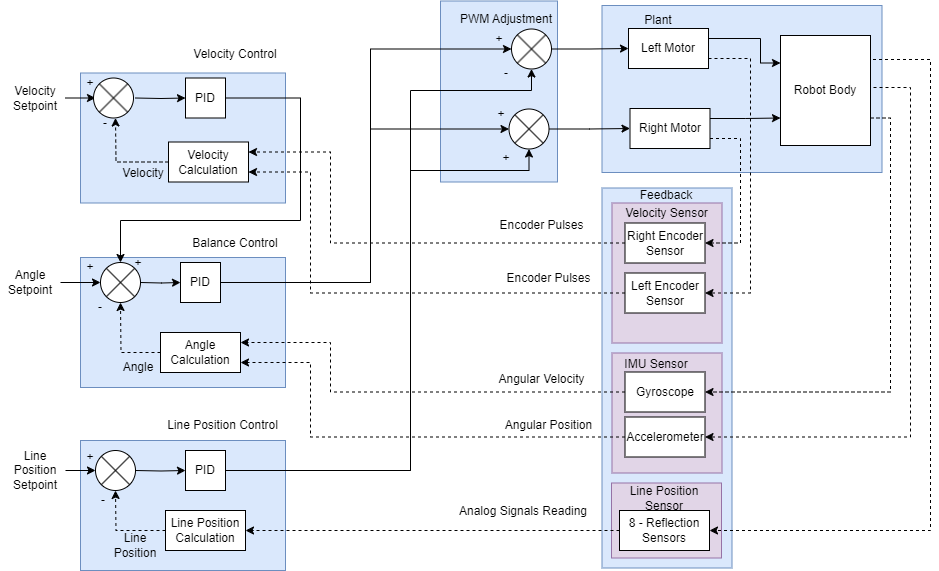
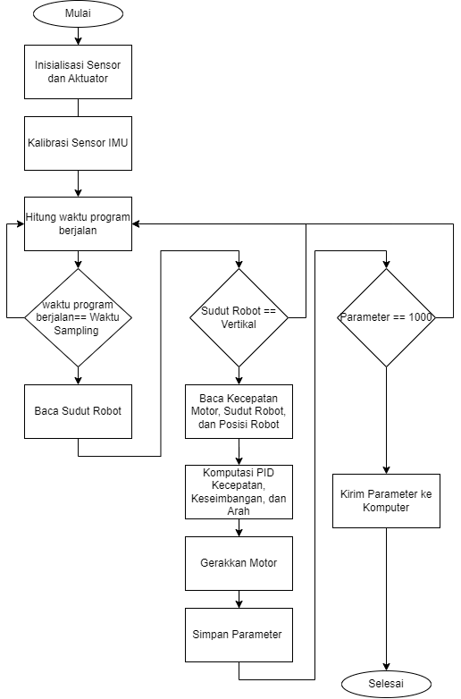
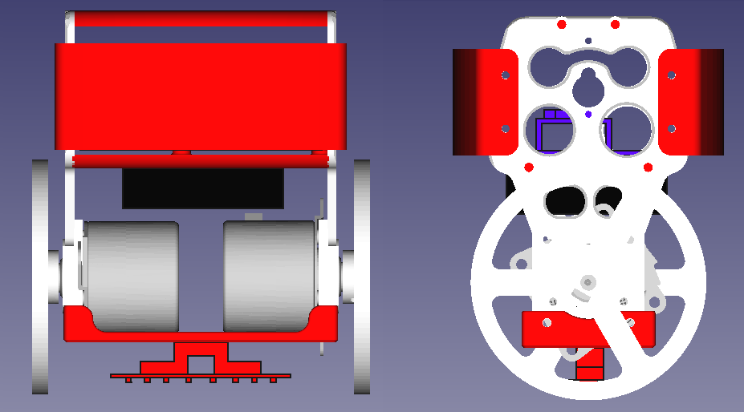
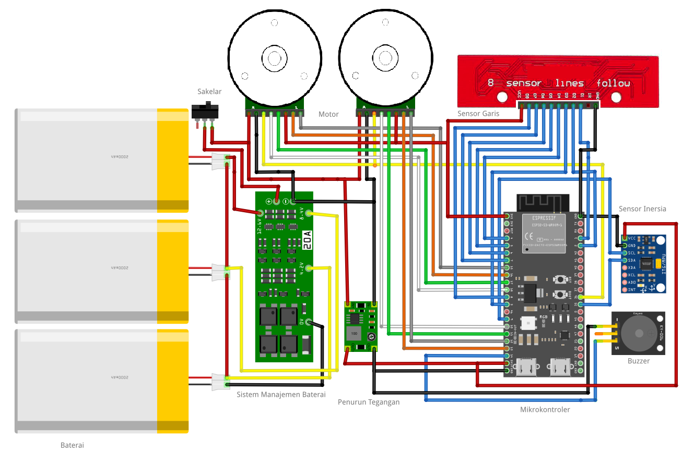
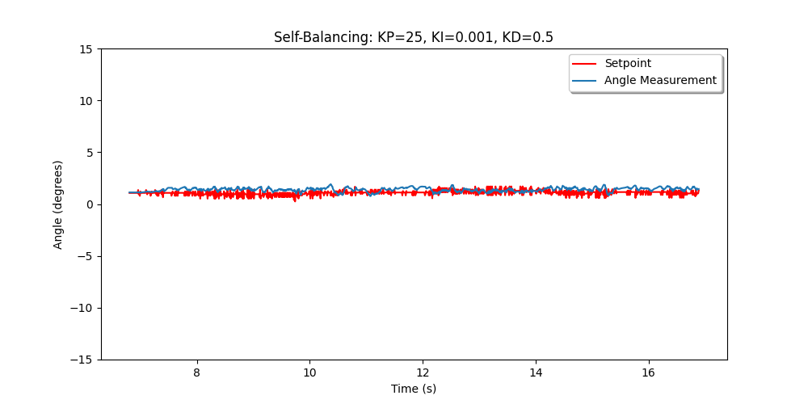
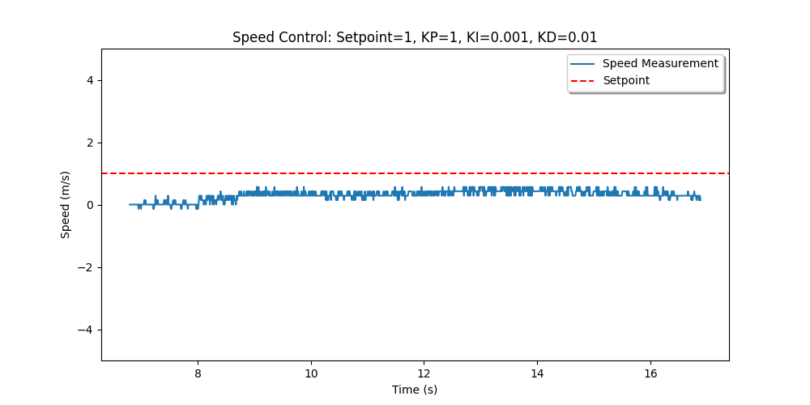

# TWSBR — Two-Wheeled Self-Balancing Line-Following Robot


A two-wheeled robot that balances itself and follows a line at the same time, using a
**cascade of three PID controllers** on an ESP32-S3, plus a small **Wi-Fi telemetry server**
that plots every run so the gains can be tuned from real data.

A personal project from 2024. This repository collects the hardware design, firmware, tuning
tools, early test results and the project plan, as an open reference for anyone building a
similar robot.

## Demo

[](https://www.youtube.com/watch?v=iszBgYYvSfs)

Test run from September 2024 (20 s, [YouTube](https://www.youtube.com/watch?v=iszBgYYvSfs)): the
robot balances and follows an oval black-line track. Like any PID loop it weaves a little around
the line, but it stays on it.

## Contents

- [Demo](#demo)
- [How it works](#how-it-works)
- [Hardware](#hardware)
- [Firmware](#firmware)
- [Telemetry server](#telemetry-server)
- [Results so far](#results-so-far)
- [Known issues](#known-issues)
- [What's next](#whats-next)
- [Repository layout](#repository-layout)
- [Ringkasan (Bahasa Indonesia)](#ringkasan-bahasa-indonesia)

## How it works



Every 10 ms the robot reads its sensors and runs three PID loops:

| Loop | Measures | Sensor | Output |
|---|---|---|---|
| **Speed** (outer) | average wheel speed (m/s) | wheel encoders | tilt-angle setpoint, clamped to ±2° |
| **Balance** (inner) | tilt angle (°) | MPU6050 + 1-D Kalman filter | common motor PWM |
| **Line** (steering) | line position (−4 … +4) | QTR-8A, 8 analog reflectance sensors | left/right PWM difference |

```
angle_sp  = PID_speed(v_sp − v)                   // lean forward to speed up
u_balance = PID_balance(angle_sp − angle)
u_steer   = PID_line(0 − line_pos)                // clamped to ±100
PWM_left  = −(u_balance − u_steer)                // clamped to ±255
PWM_right = −(u_balance + u_steer)
```

The tilt angle comes from fusing the gyroscope rate with the accelerometer angle in a 1-D Kalman
filter. The robot only starts once it is held within ±30° of upright, and brakes as soon as it
tips past ±45°.

<details>
<summary>Program flow</summary>



</details>

## Hardware

<p align="center">
  
</p>

| Part | Notes |
|---|---|
| ESP32-S3-WROOM-1 dev board | 240 MHz dual core, Wi-Fi for telemetry |
| 2 × BLDC motor with integrated driver | DIR, PWM (inverted, 20 kHz / 8-bit), shared BRAKE, quadrature encoder |
| MPU6050 | 6-axis IMU on I²C, ±2 g / ±500 °/s |
| QTR-8A | 8-channel analog reflectance array for the line |
| 3 × Li-ion cells (3S) + 3S 20 A BMS | main supply; buck converter for the logic |
| Buzzer, power switch | start beep and low-battery warning |



### Pin map

| Function | GPIO | Function | GPIO |
|---|---|---|---|
| Motor L — DIR / PWM | 17 / 18 | Motor R — DIR / PWM | 11 / 10 |
| Encoder L — A / B | 16 / 15 | Encoder R — A / B | 13 / 12 |
| Motor BRAKE (both) | 36 | Buzzer | 14 |
| MPU6050 SDA / SCL | 35 / 9 | QTR-8A outputs 1 … 8 | 1 … 8 |
| Battery sense | 21 | | |

Diagram sources (draw.io, Fritzing) are in [`docs/diagrams`](docs/diagrams).

## Firmware

Four Arduino sketches in [`firmware/`](firmware), from the first balance-only prototype to the
latest full cascade:

| Sketch | What it adds |
|---|---|
| `twsbr_v0_balance_only` | Single PID on the tilt angle |
| `twsbr_v1_cascade_pid` | Modular code, balance + line PID |
| `twsbr_v2_tuning_telemetry` | Full cascade with encoders; logs a 10 s run and sends it to the server |
| `twsbr_v3_continuous` | Latest gains, runs continuously, smoother line position |

Quick start: Arduino IDE 2 + **esp32 board package 3.x**, board **ESP32S3 Dev Module**, and
**ArduinoJson 7** for v2. Put your Wi-Fi details in `secrets.h` (copy from `secrets.example.h`).
Details and safety notes: [`firmware/README.md`](firmware/README.md).

## Telemetry server

Tuning a balancing robot by watching it fall over is slow. Firmware v2 records 1000 samples
(10 s) of speed, tilt angle, angle setpoint and line position, then POSTs them as JSON to a
Flask server on a laptop. The server saves three plots and a CSV per run, with the gains in the
plot titles, so runs can be compared side by side.

```bash
cd server
pip install -r requirements.txt
python app.py --port 5000            # plots + CSV go to server/statistic/
```

No robot at hand? Send a synthetic run to check the setup:

```bash
python send_test_payload.py http://127.0.0.1:5000/data
```

<details>
<summary>Payload format</summary>

```json
{
  "setpoint_time": 0.01,
  "measurements_time":  [0.01, 0.02, "..."],
  "setpoint_speed": 1.0,
  "measurements_speed": ["..."],
  "setpoint_angle": 2.0,
  "angle_adjustment":   ["... angle setpoint from the speed loop, per sample ..."],
  "measurements_angle": ["..."],
  "setpoint_line": 0.0,
  "measurements_line":  ["..."],
  "pid_speed": {"kp": 1.0, "ki": 0.001, "kd": 0.001},
  "pid_angle": {"kp": 25.0, "ki": 0.001, "kd": 0.5},
  "pid_line":  {"kp": 5.0, "ki": 0.001, "kd": 20.0}
}
```

`GET /` returns the server status and the latest run.

</details>

## Results so far

Testing stopped in September 2024, at the tuning stage. All 11 logged runs are in
[`docs/results/tuning-logs`](docs/results/tuning-logs).

| Balance loop (Kp 25, Ki 0.001, Kd 0.5) | Speed loop (Kp 1, Ki 0.001, Kd 0.01) |
|---|---|
|  |  |

- **Balancing works.** With Kp = 25, Ki = 0.001, Kd = 0.5 the robot stays upright for the whole
  10 s run. In the best run it tracks the angle setpoint within about ±1°.
- **The speed loop wasn't finished.** In the best runs speed settles around 0.3–0.5 m/s against a
  1 m/s setpoint (large steady-state error). In others it saturates.
- **Line following works.** On the oval test track (see the [demo](#demo)) the robot stays on the
  line while balancing. It weaves a little around the line, as expected from PID steering. The
  telemetry logs don't capture it, though: the logged line position reads 0 in every run, so there
  are no line-loop plots yet (gains used: Kp 5–7.5, Kd 12–20).

## Known issues

Found while cleaning up the code. The firmware logic is kept exactly as it was tested.

- **v2 leaves the motors running while it uploads.** After 1000 samples the control loop exits
  but the last PWM command stays active during the (blocking) Wi-Fi connect and POST.
- **The Kalman filter assumes dt = 4 ms**, but the loop runs at 10 ms (v2/v3) or 1 ms (v0/v1).
  Passing the real `dt` should make the angle estimate more accurate.
- **Encoder scaling:** the ISR counts every edge of channel A (`CHANGE`), i.e. 2 counts per
  encoder pulse, so `pulsesPerRevolution` must be 2 × the encoder's PPR. A wrong value would
  explain part of the speed loop error. The counters are also read and reset without disabling
  interrupts.
- **Motor input above 255 stops the motor.** The PWM is inverted (255 = stop) and
  `sp > 255 ? 255 : 255 - sp` maps saturation to stop. This is harmless today only because the
  callers clamp to ±255.
- **Battery sense on GPIO21 can't work.** GPIO21 has no ADC on the ESP32-S3.
- **GPIO35/36 are used for SDA/BRAKE.** On modules with octal PSRAM (…R8 variants) these pins
  belong to the PSRAM, so use a module without it (e.g. N8 / N16).
- **v1 line sensor:** the "no line" case is missing a `break`, so the last known position is
  always overwritten with 0.
- `line_following_mode` is never cleared (`robot_angle <= 0 && robot_angle > 6` is never true).
  It isn't used anywhere else yet.

## What's next

The ideas from the project plan that are still open:

1. Fix the speed measurement (scaling, atomic read) and finish tuning the speed loop.
2. Log the line position in the telemetry, then tune the steering loop for tighter tracking.
3. Compute rise time, overshoot, settling time and steady-state error from the CSV logs.
4. Tune gains from the browser over Wi-Fi instead of re-flashing.
5. Compare against a complementary filter and other controllers (LQR, fuzzy, sliding mode). See
   the [reference list](docs/references.md).

## Repository layout

```
├── firmware/
│   ├── twsbr_v0_balance_only/       single-file prototype
│   ├── twsbr_v1_cascade_pid/        modular, balance + line
│   ├── twsbr_v2_tuning_telemetry/   full cascade + Wi-Fi logging
│   └── twsbr_v3_continuous/         latest
├── server/
│   ├── app.py                       Flask telemetry server (plots + CSV)
│   ├── send_test_payload.py         synthetic run for testing
│   └── requirements.txt
└── docs/
    ├── project-plan.md              project plan (Bahasa Indonesia)
    ├── references.md / .ris         50 papers on two-wheeled robots and control
    ├── images/                      diagrams, wiring, mechanical drawing
    ├── diagrams/                    draw.io and Fritzing sources
    └── results/tuning-logs/         plots from the Sep 2024 test runs
```

## Ringkasan (Bahasa Indonesia)

Proyek pribadi (2024): **robot dua roda
self-balancing dan line-following** berbasis ESP32-S3 dengan **cascade PID** (kecepatan →
keseimbangan → PWM motor, ditambah PID garis untuk kemudi), sensor MPU6050 (Kalman filter),
QTR-8A, dan motor BLDC dengan encoder. Disertakan juga server Flask untuk merekam dan memplot
setiap percobaan lewat Wi-Fi sebagai alat bantu tuning PID.

Status terakhir (September 2024): robot sudah bisa menyeimbangkan diri (Kp 25, Ki 0,001,
Kd 0,5) dan mengikuti garis di lintasan oval
([video demo](https://www.youtube.com/watch?v=iszBgYYvSfs)). Gerakannya sedikit berkelok di
sekitar garis, wajar untuk kontrol PID, tapi tetap di garis. Loop kecepatan belum selesai dituning.
Rencana proyek lengkap ada di [docs/project-plan.md](docs/project-plan.md).

## Author

**Fitra Nurmayadi** — [github.com/fitranurmayadi](https://github.com/fitranurmayadi)

Released under the [MIT License](LICENSE). The cited papers belong to their authors and are
listed for reference only.
