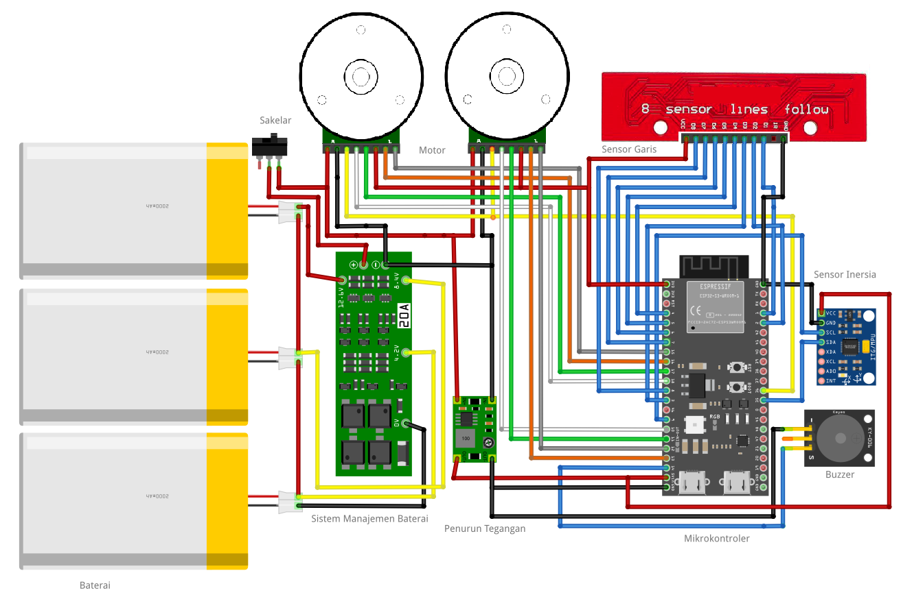
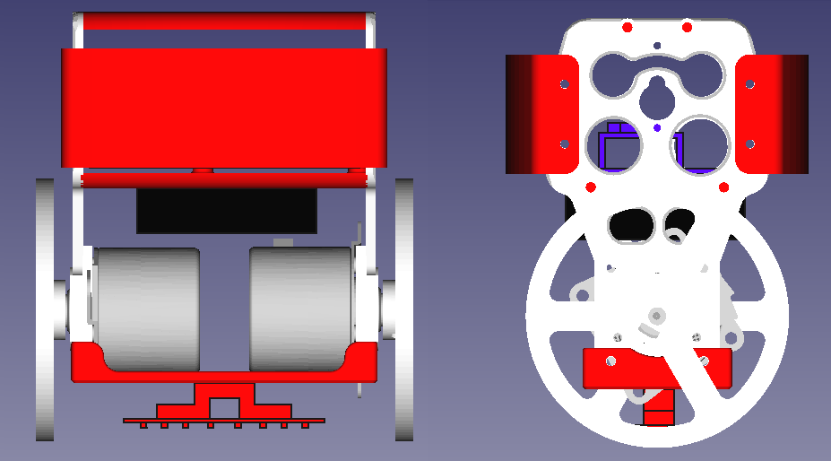
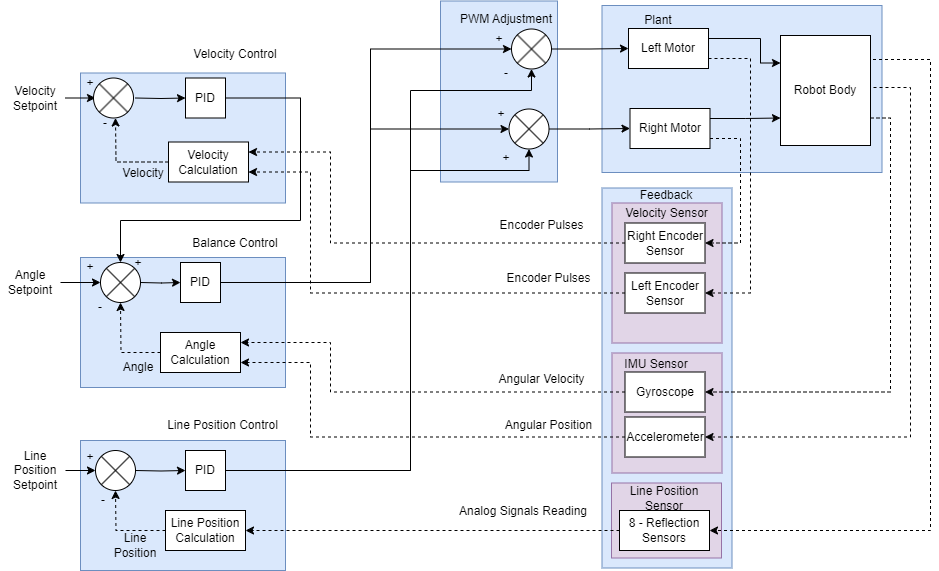
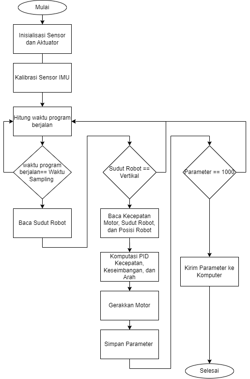

# Rencana Proyek (2024)

**Desain dan Implementasi Sistem Kontrol Berbasis Proportional Integral Derivatif untuk Robot Dua Roda Self-Balancing dan Line Following**

Fitra Nurmayadi · 2024

> Dokumen perencanaan proyek pribadi ini: latar belakang, tujuan, desain sistem, dan rencana
> pengujian. Ringkasan dalam bahasa Inggris ada di [README](../README.md).

---

## 1. Pendahuluan

### 1.1 Latar Belakang

Robot self-balancing dan line-following menggabungkan dua kemampuan: menjaga keseimbangan
robot dua roda dan mengikuti jalur secara otomatis. Keseimbangan dicapai melalui sensor
Inertial Measurement Unit (IMU) yang mengukur orientasi dan percepatan, serta kontroler
Proportional Integral Derivative (PID) yang mengoreksi sudut kemiringan secara real-time.
Kemampuan line-following memakai sensor optik QTR-8A untuk mendeteksi jalur kontras, dengan
PID untuk menyesuaikan posisi robot terhadap garis. Keduanya menuntut pemrosesan data
sensor secara simultan dan efisien.

Teknologi ini berpotensi dipakai di transportasi (kendaraan otonom, mobilitas yang menjaga
keseimbangan sendiri) dan layanan otomatis (pengiriman barang, navigasi di rumah sakit atau
gudang) yang membutuhkan presisi dan stabilitas.

Tantangan utamanya adalah mengintegrasikan dua sistem kontrol yang berbeda — keseimbangan dan
pelacakan jalur — agar berjalan bersamaan tanpa saling mengganggu, ditambah gangguan eksternal
seperti medan yang tidak rata. Karena itu diperlukan strategi kontrol dan tuning parameter yang
tepat agar keduanya bekerja harmonis dan stabil.

### 1.2 Rumusan Masalah

Merancang dan mengimplementasikan sistem kontrol berbasis PID untuk robot dua roda yang mampu
melakukan self-balancing dan line-following secara efektif, serta melihat pengaruh penggunaan
**cascade PID** (kecepatan motor, keseimbangan, dan pengikut garis) terhadap kinerja robot dalam
kondisi nyata.

### 1.3 Pertanyaan yang Ingin Dijawab

1. Bagaimana mendesain dan mengimplementasikan sistem kontrol PID untuk robot dua roda yang dapat
   menjaga keseimbangan dan mengikuti garis?
2. Bagaimana parameter PID (proporsional, integral, derivatif) memengaruhi kinerja robot dalam
   menjaga keseimbangan dan mengikuti garis?
3. Bagaimana melakukan tuning PID yang optimal untuk performa terbaik dalam kondisi nyata?

### 1.4 Hipotesis

1. Cascade PID untuk kecepatan motor, keseimbangan, dan line-following menghasilkan performa yang baik.
2. Parameter PID yang tepat meningkatkan stabilitas dan akurasi robot.
3. Teknik tuning yang optimal mengurangi waktu respons dan meningkatkan kinerja robot dalam kondisi nyata.

### 1.5 Tujuan

1. Mendesain dan mengimplementasikan sistem kontrol PID untuk robot dua roda self-balancing dan line-following.
2. Mengevaluasi efektivitas penggunaan tiga kontroler PID terhadap performa robot.
3. Mengoptimalkan parameter PID untuk keseimbangan dan pengikutan garis yang lebih baik.
4. Menyediakan panduan praktis pengaturan PID untuk robot dua roda.

### 1.6 Ruang Lingkup

- **Desain sistem kontrol:** PID untuk aspek keseimbangan dan line-following.
- **Parameter PID:** pengaturan dan tuning untuk performa optimal.
- **Pengujian:** pada robot nyata, dengan fokus pada stabilitas, akurasi, dan respons.
- **Perangkat keras:** ESP32-S3, sensor QTR-8A, MPU6050, dan motor BLDC.

### 1.7 Manfaat

- Solusi pengendalian robot dua roda untuk aplikasi self-balancing dan line-following.
- Pemahaman penggunaan PID pada sistem robotika beserta tantangannya.
- Kontribusi pengetahuan di bidang robotika dan kontrol PID sebagai referensi untuk proyek berikutnya.

## 2. Tinjauan Pustaka (ringkas)

- **Robot self-balancing** memakai IMU untuk mendeteksi sudut kemiringan dan PID untuk mengatur
  kecepatan motor agar robot tetap tegak. Sensor fusion (akselerometer + giroskop) meningkatkan
  akurasi sudut, terutama saat ada gangguan.
- **Robot line-following** memakai sensor garis untuk mengukur deviasi dari jalur; PID mengoreksi
  arah dan kecepatan. Encoder membantu akurasi kontrol kecepatan dan posisi.
- **Cascade PID** memakai beberapa kontroler berjenjang: satu untuk kecepatan, satu untuk
  keseimbangan, satu untuk arah. Koordinasi ketiganya menjadi kunci agar robot seimbang sambil
  mengikuti jalur.
- **Sensor fusion:** *complementary filter* (θ = α·θ_gyro + (1 − α)·θ_acc) sederhana dan ringan;
  *Kalman filter* (prediksi + koreksi) lebih akurat menghadapi noise dan drift. Robot ini memakai
  Kalman filter 1-D.

Daftar pustaka lengkap: [references.md](references.md).

## 3. Metodologi

### 3.1 Desain Sistem

ESP32-S3 sebagai mikrokontroler, dua motor BLDC dengan encoder sebagai penggerak, MPU6050 untuk
sudut kemiringan, dan QTR-8A untuk posisi terhadap garis.

### 3.2 Algoritma Kontrol

Tiga kontroler PID bekerja bersamaan:

- **PID kecepatan** — umpan balik encoder, keluarannya menjadi setpoint sudut.
- **PID keseimbangan** — umpan balik sudut dari IMU, keluarannya PWM motor.
- **PID arah (line-following)** — umpan balik posisi garis, keluarannya koreksi kiri/kanan.

Kalman filter menggabungkan akselerometer dan giroskop untuk estimasi sudut yang stabil.

### 3.3 Pengujian

Pengujian dilakukan secara real-time di lingkungan nyata. Setiap percobaan merekam 1000 data
(sudut kemiringan, kecepatan motor, posisi terhadap garis) yang dikirim ke komputer lewat Wi-Fi
dan ditampilkan sebagai grafik. Berdasarkan grafik tersebut, nilai Kp, Ki, dan Kd dituning hingga
respons stabil.

## 4. Hasil yang Diharapkan

Robot mampu tetap tegak, responsif terhadap gangguan, dan mengikuti jalur dengan akurat. Kinerja
dievaluasi dengan:

- **Rise time** — kecepatan mencapai nilai target setelah gangguan atau perintah baru.
- **Overshoot** — memastikan tidak ada gerakan berlebih yang memicu ketidakstabilan.
- **Settling time** — waktu hingga kondisi stabil.
- **Steady-state error** — akurasi setelah stabil, baik untuk keseimbangan maupun garis.

Data diambil pada variasi kecepatan, jenis lintasan, dan medan.

## 5. Jadwal

| Tahap | Kegiatan | Bulan |
|---|---|---|
| 1 | Studi literatur dan desain awal sistem | 1–2 |
| 2 | Implementasi hardware dan integrasi komponen | 3–4 |
| 3 | Pengembangan algoritma kontrol dan sensor fusion | 5–6 |
| 4 | Pengujian sistem dan optimasi | 7–8 |
| 5 | Analisis hasil dan penulisan laporan | 9–10 |

## 6. Sumber Daya

- **Hardware:** ESP32-S3, motor BLDC dengan encoder, MPU6050, QTR-8A.
- **Software:** Arduino IDE; Python (Flask, Matplotlib) untuk server telemetri.
- **Lingkungan uji:** lintasan garis hitam-putih dan area uji keseimbangan.
