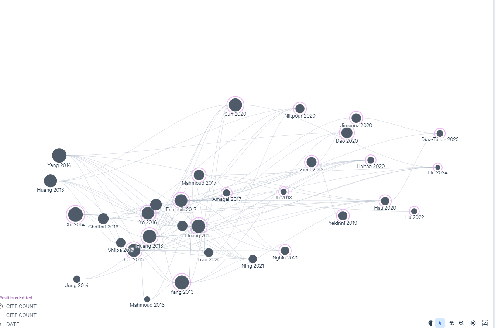
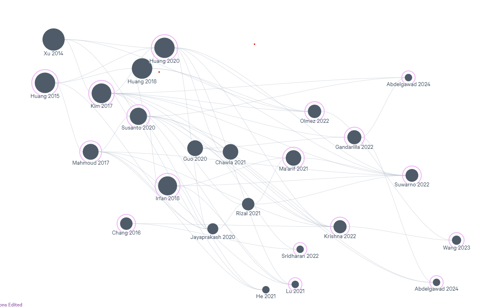

# References

Literature collected while planning the project: two-wheeled self-balancing robots,
inverted-pendulum control, PID / cascade PID, sensor fusion and line following.
Only citations are listed here; the papers themselves are not redistributed.

A citation file you can import into Zotero / Mendeley is in [`references.ris`](references.ris).

## Papers (50)

1. Chan et al. (2013). Review of modelling and control of two-wheeled robots. *Annual Reviews in Control*. [link](https://doi.org/10.1016/j.arcontrol.2013.03.004)
1. Huang et al. (2013). Modeling and velocity control for a novel narrow vehicle based on mobile wheeled inverted pendulum. *IEEE Transactions on Control Systems Technology*. [link](https://doi.org/10.1109/TCST.2012.2214439)
1. Yang et al. (2013). Trajectory planning and optimized adaptive control for a class of wheeled inverted pendulum vehicle models. *IEEE Transactions on Cybernetics*. [link](https://doi.org/10.1109/TSMCB.2012.2198813)
1. Xu et al. (2014). Design and implementation of integral sliding-mode control on an underactuated two-wheeled mobile robot. *IEEE Transactions on Industrial Electronics*. [link](https://doi.org/10.1109/TIE.2013.2282594)
1. Dai et al. (2015). A two-wheeled inverted pendulum robot with friction compensation. *Mechatronics*. [link](https://doi.org/10.1016/j.mechatronics.2015.06.011)
1. Huang et al. (2015). Nonlinear Disturbance Observer-Based Dynamic Surface Control of Mobile Wheeled Inverted Pendulum. *IEEE Transactions on Control Systems Technology*. [link](https://doi.org/10.1109/TCST.2015.2404897)
1. Mayr et al. (2015). Mechatronic design of a self-balancing three-dimensional inertia wheel pendulum. *Mechatronics*. [link](https://doi.org/10.1016/j.mechatronics.2015.04.019)
1. Ye et al. (2015). Vision-based human tracking control of a wheeled inverted pendulum robot. *IEEE Transactions on Cybernetics*. [link](https://doi.org/10.1109/TCYB.2015.2478154)
1. Ghaffari et al. (2016). A modified dynamical formulation for two-wheeled self-balancing robots. *Nonlinear Dynamics*. [link](https://doi.org/10.1007/s11071-015-2321-9)
1. Esmaeili et al. (2017). Balancing and Trajectory Tracking of Two-Wheeled Mobile Robot Using Backstepping Sliding Mode Control: Design and Experiments. *Journal of Intelligent and Robotic Systems: Theory and Applications*. [link](https://doi.org/10.1007/s10846-017-0486-9)
1. Kim & Kwon (2017). Nonlinear optimal control design for underactuated two-wheeled inverted pendulum mobile platform. *IEEE/ASME Transactions on Mechatronics*. [link](https://doi.org/10.1109/TMECH.2017.2767085)
1. Mahmoud & Nasir (2017). Robust control design of wheeled inverted pendulum assistant robot. *IEEE/CAA Journal of Automatica Sinica*. [link](https://doi.org/10.1109/JAS.2017.7510613)
1. Rahman et al. (2018). Comparison of Different Control Theories on a Two Wheeled Self Balancing Robot. [link](https://doi.org/10.1063/1.5044373)
1. Rahman et al. (2018). Implementation of Q learning and deep Q network for controlling a self balancing robot model. *Robotics and Biomimetics*. [link](https://doi.org/10.1186/s40638-018-0091-9)
1. Rostami et al. (2018). Real-time obstacle avoidance of mobile robots using state-dependent Riccati equation approach. *Eurasip Journal on Image and Video Processing*. [link](https://doi.org/10.1186/s13640-018-0319-1)
1. Zimit et al. (2018). Modelling and experimental analysis two-wheeled self balance robot using PID controller. *Lecture Notes in Computer Science (including subseries Lecture Notes in Artificial Intelligence and Lecture Notes in Bioinformatics)*. [link](https://doi.org/10.1007/978-3-319-95165-2_48)
1. Goher & Fadlallah (2019). Control of a Two-wheeled Machine with Two-directions Handling Mechanism Using PID and PD-FLC Algorithms. *International Journal of Automation and Computing*. [link](https://doi.org/10.1007/s11633-019-1172-0)
1. Mehrvarz et al. (2019). A New Dynamic Model of a Two-Wheeled Two-Flexible-Beam Inverted Pendulum Robot. [link](https://doi.org/10.1115/IMECE2020-24078)
1. Gonzalez et al. (2020). Line walking and balancing for legged robots with point feet. *IEEE International Conference on Intelligent Robots and Systems*. [link](https://doi.org/10.1109/IROS45743.2020.9341743)
1. Hsu & Kao (2020). Double-loop fuzzy motion control with CoG supervisor for two-wheeled self-balancing assistant robots. *International Journal of Dynamics and Control*. [link](https://doi.org/10.1007/s40435-020-00617-y)
1. Huang et al. (2020). High-Order Disturbance-Observer-Based Sliding Mode Control for Mobile Wheeled Inverted Pendulum Systems. *IEEE Transactions on Industrial Electronics*. [link](https://doi.org/10.1109/TIE.2019.2903778)
1. Iswanto et al. (2020). Using a Combination of PID Control and Kalman Filter to Design of IoT-based Telepresence Self-balancing Robots during COVID-19 Pandemic. *Emerging Science Journal*. [link](https://doi.org/10.28991/esj-2021-SP1-016)
1. Jiménez et al. (2020). Modeling and control of a two wheeled auto-balancing robot: A didactic platform for control engineering education. *Proceedings of the LACCEI international Multi-conference for Engineering, Education and Technology*. [link](https://doi.org/10.18687/LACCEI2020.1.1.556)
1. Johnson et al. (2020). Implementation of a Perceptual Controller for an Inverted Pendulum Robot. *Journal of Intelligent and Robotic Systems: Theory and Applications*. [link](https://doi.org/10.1007/s10846-020-01158-4)
1. Nikpour et al. (2020). Stability and Direction Control of a Two-Wheeled Robotic Wheelchair through a Movable Mechanism. *IEEE Access*. [link](https://doi.org/10.1109/ACCESS.2020.2976503)
1. Rigatos et al. (2020). Nonlinear Optimal Control for the Wheeled Inverted Pendulum System. *Robotica*. [link](https://doi.org/10.1017/S0263574719000456)
1. Shen & Hong (2020). OmBURo: A Novel Unicycle Robot with Active Omnidirectional Wheel. [link](http://arxiv.org/abs/2001.07856)
1. Sun et al. (2020). Adaptive Tracking Control of Wheeled Inverted Pendulums with Periodic Disturbances. *IEEE Transactions on Cybernetics*. [link](https://doi.org/10.1109/TCYB.2018.2884707)
1. Tian et al. (2020). Control of different-axis two-wheeled self-balancing vehicles. *IEEE Access*. [link](https://doi.org/10.1109/ACCESS.2020.3019538)
1. Tran et al. (2020). Observer-Based Controllers for Two-Wheeled Inverted Robots with Unknown Input Disturbance and Model Uncertainty. *Journal of Control Science and Engineering*. [link](https://doi.org/10.1155/2020/7205737)
1. Anonymous (undergraduate final report) (2021). RANCANG BANGUN SELF BALANCING ROBOT LINE FOLLOWER MENGGUNAKAN MIKROKONTROLER ARDUINO NANO.
1. Dao & Liu (2021). Adaptive Reinforcement Learning Strategy with Sliding Mode Control for Unknown and Disturbed Wheeled Inverted Pendulum. *International Journal of Control, Automation and Systems*. [link](https://doi.org/10.1007/s12555-019-0912-9)
1. Haitao et al. (2021). Control of the two-wheeled inverted pendulum (TWIP) robot in presence of model uncertainty and motion restriction. *Industrial Robot*. [link](https://doi.org/10.1108/IR-03-2020-0064)
1. Kanishk et al. (2021). Analysis of Model-Free Reinforcement Learning Control Schemes on self-balancing Wheeled Extendible System. [link](http://arxiv.org/abs/2111.08389)
1. Nikita & Prajwal (2021). PID Controller Based Two Wheeled Self Balancing Robot. *Proceedings of the 5th International Conference on Trends in Electronics and Informatics, ICOEI 2021*. [link](https://doi.org/10.1109/ICOEI51242.2021.9453091)
1. Velagic et al. (2021). Design and Control of Two-Wheeled and Self-Balancing Mobile Robot. *Proceedings Elmar - International Symposium Electronics in Marine*. [link](https://doi.org/10.1109/ELMAR52657.2021.9550938)
1. Gandarilla et al. (2022). Trajectory tracking control of a self-balancing robot via adaptive neural networks. *Engineering Science and Technology, an International Journal*. [link](https://doi.org/10.1016/j.jestch.2022.101259)
1. Krishna et al. (2022). Epersist: A Self Balancing Robot Using PID Controller And Deep Reinforcement Learning. [link](http://arxiv.org/abs/2207.11431)
1. Nghia et al. (2022). Adaptive neural sliding mode control for two wheel self balancing robot. *International Journal of Dynamics and Control*. [link](https://doi.org/10.1007/s40435-021-00832-1)
1. Cao et al. (2023). DoubleBee: A Hybrid Aerial-Ground Robot with Two Active Wheels. [link](http://arxiv.org/abs/2303.05075)
1. Díaz-Téllez et al. (2023). ROS-based Controller for a Two-Wheeled Self-Balancing Robot. *Journal of Robotics and Control (JRC)*. [link](https://doi.org/10.18196/jrc.v4i4.18208)
1. Lee et al. (2023). Design and Implementation of a Two-Wheeled Inverted Pendulum Robot With a Sliding Mechanism for Off-Road Transportation. *IEEE Robotics and Automation Letters*. [link](https://doi.org/10.1109/LRA.2023.3279585)
1. Abdelgawad et al. (2024). Model- and Data-Based Control of Self-Balancing Robots: Practical Educational Approach with LabVIEW and Arduino. *IFAC-PapersOnLine*. [link](https://doi.org/10.1016/j.ifacol.2024.07.399)
1. Hu et al. (2024). Optimization-based adaptive trajectory tracking controller design of self-balanced vehicle with asymptotic prescribed performance. *ISA Transactions*. [link](https://doi.org/10.1016/j.isatra.2024.02.031)
1. Kawaharazuka et al. (2024). TWIMP: Two-Wheel Inverted Musculoskeletal Pendulum as a Learning Control Platform in the Real World with Environmental Physical Contact. [link](https://doi.org/10.1109/HUMANOIDS.2018.8624923)
1. Al Morshed & Maruf (n.d.). Electromechanical System Design for Self-Balancing Robot.
1. Erfan Arefin (n.d.). Simple Two-wheel Self-Balancing Robot Implementation.
1. Hsu et al. (n.d.). VISION-BASED LINE-FOLLOWING CONTROL OF A TWO-WHEEL SELF-BALANCING ROBOT.
1. Maniha Abdul Ghani et al. (n.d.). Two Wheels Balancing Robot with Line Following Capability.
1. Setiawan et al. (n.d.). SELF-BALANCING ROBOT BERODA DUA DENGAN METODE PID.

## Literature maps

Citation maps used to find related work (node size = citation count):

